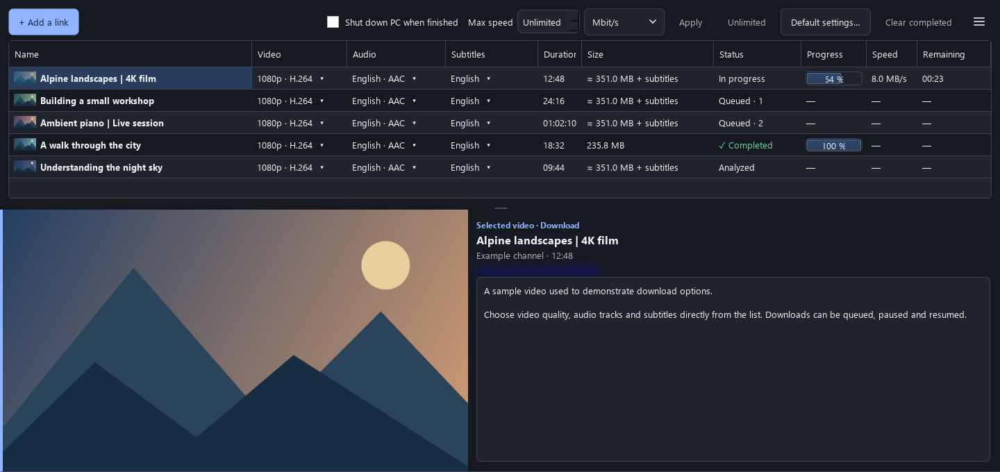

# YouTube Download Helper

A portable Windows app to download YouTube videos, audio and subtitles.



## Features

- Choose video quality, codecs, audio languages and SRT subtitles.
- Download clips without re-encoding, with synchronized subtitles.
- Queue downloads, pause and resume, set speed limits and restore saved sessions.
- English/French interface with light, dark and system themes.

## Quick start

1. Extract the release and keep `_dependencies` next to the executable. No Python installation required.
2. Launch the app and click **Add a link**.
3. Choose your streams, right-click the row, select **Download** and choose a destination folder.

Change the language or theme from the **☰** menu.

## YouTube access and recovery

Stream refusals, rate limits, incomplete format lists and network timeouts trigger different recovery steps:

- **Automatic fallbacks:** start with yt-dlp's usual clients and BgUtils tokens, then try another client when needed. A failed token provider can be skipped. Selected quality is preserved.
- **Bounded retries:** metadata analysis has time limits; rate-limited requests retry after a delay. Full downloads get up to three extra attempts for temporary network failures. Stalled transfers are stopped rather than left waiting indefinitely.
- **Unavailable formats:** refresh the video’s streams and retry when the selected formats have a clear equivalent. If the selection cannot be recovered, choose from the refreshed formats.
- **Google verification:** when needed, the app offers an isolated browser window for you to complete the check. It then resumes the same request using that session, without repeatedly reopening verification if access remains blocked.
- **Separate subtitle recovery:** retry temporary failures up to five times per language. Auto-translated captions may wait before requesting them. A subtitle failure keeps the downloaded video; only missing subtitles need another attempt.
- **Safe resume:** reopening the app resumes a transfer that was running at exit and continues the queue. Manually paused transfers can be resumed from the list. The app keeps partial files and the destination folder. Clips never silently fall back to downloading the entire video.

Diagnostics record errors and recovery attempts while masking credentials and signed URLs. Persistent YouTube restrictions may still require waiting.

## Built with

- [yt-dlp](https://github.com/yt-dlp/yt-dlp) — video extraction and downloads.
- [FFmpeg / FFprobe](https://ffmpeg.org/about.html) — media merging, clipping, subtitles and stream inspection.
- [Qt for Python (PySide6)](https://doc.qt.io/qtforpython-6/) — desktop interface and translations.
- [Node.js](https://nodejs.org/) and [BgUtils PO Token Provider](https://github.com/Brainicism/bgutil-ytdlp-pot-provider) — JavaScript execution and YouTube access tokens.
- [Python](https://www.python.org/) and [PyInstaller](https://pyinstaller.org/) — application code and Windows packaging.

## Build

On Windows with Python 3.11+ and the local dependencies available:

```powershell
python build_exe.py
```

The build runs the tests and packages the app with its Qt translations. Restart the app after updating the executable.
